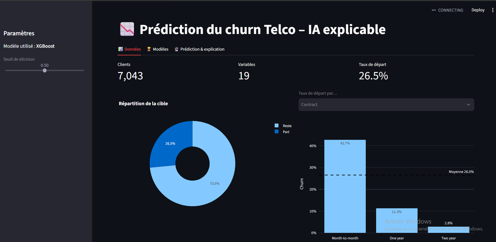
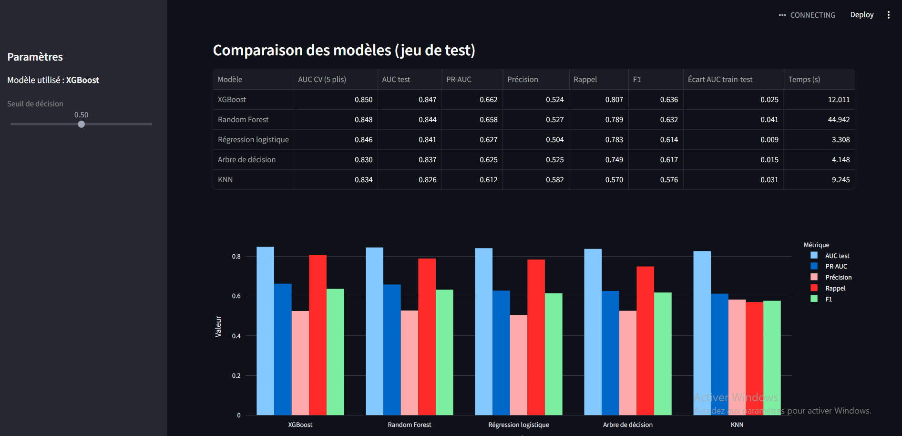
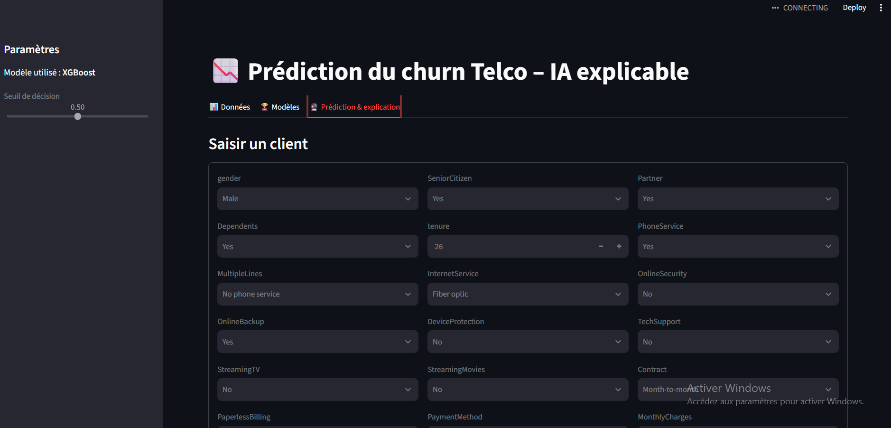
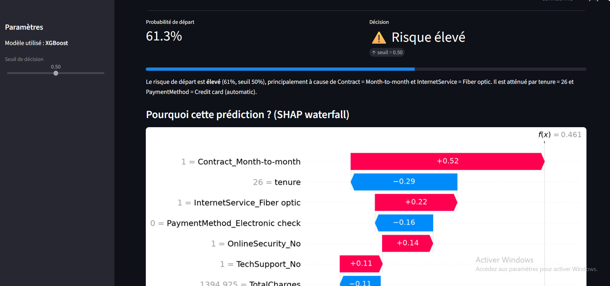

# Telecom operator customer  churn prediction with XAI

## Project summary 
The idea of this project is to predict if a given Teleco client will churn or not based on a set of features.We used five tuned classifiers compared, with SHAP and LIME explanations and a Streamlit app to predict and explain individual customers.

## Data
[Telco Customer Churn (IBM, Kaggle)](https://www.kaggle.com/datasets/blastchar/telco-customer-churn) – 7 043 clients, 20 features, target `Churn` (~26,5 % de departure).

## Notebook content
1. Loading and Cleaning (TotalCharges converted to numeric, 11 empty values = clients with tenure = 0)
2. Exploration: distributions, churn rate by category, correlations
3. Preparation: imputation, normalization, encoding, stratified split (data leakage-free pipeline)
4. Modeling: logistic regression, decision tree, KNN, Random Forest, XGBoost (GridSearchCV, 5 folds)
5. Evaluation: AUC-ROC, PR-AUC, precision, recall, F1-score, confusion matrices, decision threshold
6. Explainability: native and permutation feature importance, SHAP (beeswarm, dependence, waterfall), LIME, summary statement, fairness analysis

## Results
| Model | AUC CV | AUC test | Recall | F1 |
|---|---|---|---|---|
| Logistic regression | 0,846 | 0.841 |0.783|0.614|
| Decision tree | 0,832 |0.837 | 0.749| 0.617|
| KNN | 0,835 |0.826 | 0.570|0.582 |
| Random Forest | 0,848 |0.844 |0.789 |0.632|
| XGBoost | 0.850| 0.847|0.807 | 0.636|

## Streamlit web app 

**Web app interface showing data distribution and statistics** 
 

**Summary table of model's metrics and bar plot** 
 

**Features we can set for a customer to see the results** 
 

**Prediction results with SHAP explainability** 

